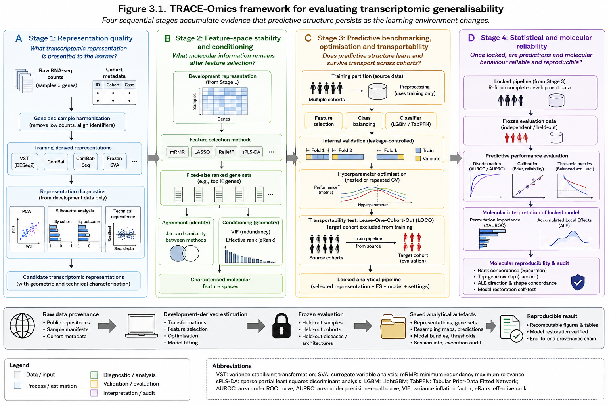

# TRACE-Omics

**Transcriptomic Robustness Assessment and Cross-cohort Evaluation for Omics**

TRACE-Omics is the computational framework developed for the dissertation **_Performance of AI algorithms on omics data_**. It was designed for high-dimensional blood RNA-seq classification where analytical conclusions may depend on preprocessing, feature selection, class handling, classifier architecture, sampling conditions and the population used for evaluation.

The framework treats two questions separately:

- **Analytical robustness:** does a conclusion persist under a specified perturbation?
- **Population scope:** does predictive performance extend to new observations from represented populations, to an omitted study population, or to an omitted disease population?

In the dissertation, sample-level holdout evaluation supplied evidence for **population generalisability**, complete-study exclusion evaluated **study transportability**, and complete-disease exclusion evaluated **disease transportability**.



## Repository status

This repository is a **source release assembled from the surviving dissertation code, reconstructed stage scripts, configuration records and analytical documentation**. It preserves the code used or developed across the TRACE-Omics analyses while making the boundaries of numerical reproduction explicit.

The public repository does not contain the harmonised count matrices, frozen participant manifests, fitted preprocessing objects, historical tuning archives or the TabPFN checkpoint. Exact numerical reproduction therefore requires the corresponding author-side analytical state. The code and documentation are suitable for audit, adaptation and rerunning once those inputs are supplied. See [`docs/REPRODUCTION_STATUS.md`](docs/REPRODUCTION_STATUS.md).

## Final dissertation design

The final analytical specification is recorded in [`config/final_dissertation.yml`](config/final_dissertation.yml). The principal analyses were:

1. **Complete pipeline comparison:** 105 preprocessing–FS–classifier pipelines for TB, RA, UC and CD, followed by frozen sample-level holdout evaluation.
2. **Equal-size sensitivity analysis:** 100 study-aware repetitions of 82 observations per disease, comprising 41 cases and 41 controls, for TB, RA, UC and CD.
3. **Study transportability:** leave-one-study-out cross-validation using RF-importance selection and RF classification under source-only transformations.
4. **Matched architecture comparison:** LightGBM and TabPFN evaluated with identical observations and 100 RF-selected genes.
5. **Disease-population evaluation:** matched pooled Models A and B on a fixed 4,450-gene feature set and common 762-observation holdout, followed by analytical-specification sensitivity analysis and leave-one-disease-out cross-validation.

A section-by-section mapping to the dissertation is provided in [`docs/METHODS_TO_CODE.md`](docs/METHODS_TO_CODE.md).

## Four-stage implementation

The repository retains the four TRACE-Omics stage entry points described in Appendix A:

```text
scripts/01_representation_specification.R
scripts/02_feature_set_characterisation.R
scripts/03_model_development_optimisation.R
scripts/04_model_testing_reliability.R
```

The comprehensive recovered implementations are stored in matching stage subdirectories so later stages can import their function definitions. Historical variable names such as `representation` are retained inside code where changing them would obscure provenance; the dissertation uses **preprocessing strategy** as the statistical term.

## Quick start

Run from the repository root in a clean R session.

```bash
Rscript scripts/00_check_environment.R
Rscript tests/parse_all.R
Rscript tests/test_core.R
```

Prepare gene-by-sample count matrices and metadata according to [`data/README.md`](data/README.md) and [`docs/DATA_CONTRACT.md`](docs/DATA_CONTRACT.md). The exact final dissertation design is documented in `config/final_dissertation.yml`; the reconstructed four-stage implementation uses `config/framework_reconstruction.yml` and requires local paths to be supplied.

Example stage execution:

```bash
Rscript scripts/01_representation_specification.R --config=config/framework_reconstruction.yml --mode=all
Rscript scripts/02_feature_set_characterisation.R --config=config/framework_reconstruction.yml --mode=all
Rscript scripts/03_model_development_optimisation.R --config=config/framework_reconstruction.yml --mode=all
Rscript scripts/04_model_testing_reliability.R --config=config/framework_reconstruction.yml --mode=all
```

Study transportability and matched-architecture utilities retained from the portable reconstruction are also available as `scripts/05_study_transportability.R` and `scripts/08_matched_architectures.R`.

## Reproducibility controls

TRACE-Omics uses project seed **7832** with the recorded R generator specification:

```r
RNGkind("Mersenne-Twister", "Inversion", "Rejection")
set.seed(7832)
```

The workflow records sample and study provenance, partition manifests, preprocessing states, selected genes, resampling assignments, classifier specifications, development-derived thresholds, prediction probabilities and software-session information where available. All data-adaptive operations are designed to be estimated inside the relevant training partition before application to validation or evaluation observations.

## Data

The 13 analytical data-sets were derived from 11 public sources. Repository accessions are listed in [`data/study_registry.csv`](data/study_registry.csv). Public availability of a study does not uniquely determine the exact curated analytical subset; participant-level eligibility and provenance records remain part of the reproducibility state.

## Computational environment

Interactive development, molecular-data processing and intermediate validation were performed on the in-house **Gaia** server with **512 GB RAM, 28 TB RAID 60 storage and dual Intel Xeon Gold processors**. Computationally demanding analyses were distributed according to memory and processing requirements. R coordinated the principal workflow, while the matched LightGBM–TabPFN analysis used Python through `reticulate`.

## Citation

Citation metadata are provided in [`CITATION.cff`](CITATION.cff). Until the dissertation has completed examination, cite the dissertation together with the repository commit used for a given analysis.

## Licence

A software licence has deliberately not been selected in this release candidate. See [`LICENSE_NOTICE.md`](LICENSE_NOTICE.md) before making the repository public.
